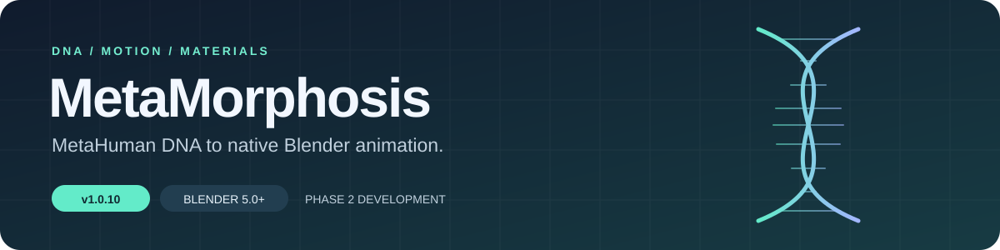
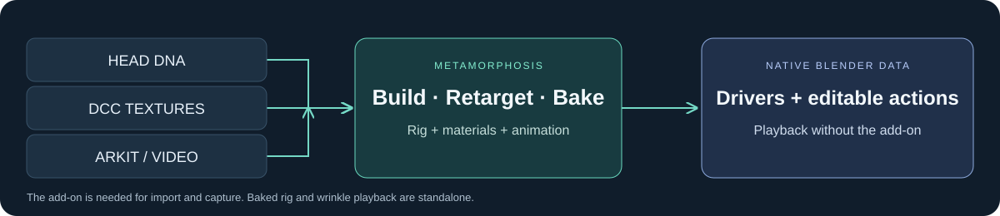

<p align="center">
  
</p>

<p align="center">
  <strong>MetaHuman heads · Native facial drivers · Capture · Animated materials</strong><br>
  Development version <strong>1.2.2</strong> · Blender <strong>5.0+</strong> · <strong>Lite</strong> rig mode
</p>

<p align="center">
  <a href="#quick-start">Quick start</a> ·
  <a href="#materials-and-wrinkles">Materials</a> ·
  <a href="#facial-capture">Capture</a> ·
  <a href="#verification-and-performance">Verification</a> ·
  <a href="docs/CHANGELOG.md">Changelog</a>
</p>

---

MetaMorphosis imports a MetaHuman head DNA file, builds its original deformation rig and face board, and compiles RigLogic into **native Blender drivers and Geometry Nodes**. Imported facial controls and wrinkle animation continue working when the add-on is disabled. Capture requires the add-on while receiving or processing input; baked takes are native Blender actions.

## What’s included

| Feature | Current development stage |
| :--- | :--- |
| **DNA import** | Head meshes, original skeleton, face board, organized object and bone collections |
| **Native facial rig** | Lite-only drivers, shared middle-eye control, mouth/jaw combination correctives |
| **Materials & wrinkles** | Compact shader groups, bundled detail/teeth/lash textures, procedural eye edges, native DNA animated-map drivers |
| **Live Link Face** | Epic ARKit UDP preview, countdown recording and editable animation takes |
| **Video to Mocap** | Local facial tracking, background processing, cancellation and action baking |
| **Scene cleanup** | Remove All targets imported content and preserves unrelated/shared data |

<p align="center">
  
</p>

## Quick start

1. **Install the extension** through Blender’s **Preferences → Get Extensions → Install from Disk**, then restart Blender. For an existing development installation, update its source files and reload the add-on.
2. **Check import resources.** The add-on uses `assets/face_board.blend` and compatible OpenRigLogic bindings in `bindings/`. Preferences provide overrides; **Test Bindings** checks availability. Binding discovery matches Blender’s Python version.
3. **Choose textures, if needed.** In the MetaMorphosis sidebar, set **Materials and Textures → Textures Folder** to your Unreal DCC export root or its `Maps` folder. Leave it blank to import without textures.
4. **Import the head DNA** using **Import DNA**, or **File → Import → MetaHuman Head DNA (MetaMorphosis)**.
5. **Animate the face board**, connect Live Link, or process a video. Import details and warnings appear in the **MetaMorphosis Report** text block.

> **Updating an existing scene:** use **Rebuild Drivers** to receive rig fixes and optimization; the original DNA and compatible bindings must remain available. Use **Apply Materials to Rig** to assign the new material setup. Capture improvements apply to new takes; existing actions remain unchanged.

**1.2.2 performance update:** reload the updated add-on and use **Rebuild Drivers** on existing rigs. Large joint calculations now run in a native Geometry Nodes graph, retaining every coefficient from the combined-mouth fix. Face controls, actions and materials are preserved. The generated rig still works with the add-on disabled; no extra installation is needed.

New 1.2 imports omit eye-shell/cartilage and create separate left/right eye edges. Reimport the DNA to receive these mesh changes in an older scene; applying materials preserves its existing geometry and reports combined legacy eye edges.

## Materials and wrinkles

Select a DCC export root or its `Maps` folder. `ExportManifest.json`, when present, supplies additional texture-folder locations.

```text
CHARACTER_EXPORT/
├── head.dna
├── ExportManifest.json
├── Maps/
│   ├── Head_Basecolor.png
│   ├── Head_Normal.png
│   ├── Head_SRMF.png
│   ├── Head_Basecolor_Animated_CM1.png   # CM1–CM3
│   ├── Head_Normal_Animated_WM1.png     # WM1–WM3
│   └── Eyes_Color.png / Eyes_Normal.png
└── Masks/                              # Not required by the bundled atlas shader
```

| Layer | Setup |
| :--- | :--- |
| **Skin** | Subsurface scattering, SRMF specular/roughness/metallic/fuzz, native DirectX normal setting in Blender 5.2 |
| **Fine detail** | Supplied tiled micro-normal textures, packed into the scene |
| **Wrinkles** | Exported animated color/normal maps, bundled mask atlas, DNA-driven weights |
| **Eyes** | Exported character color and normal maps |
| **Teeth** | Bundled universal color and normal maps, packed into the scene |
| **Eyelashes** | Bundled grayscale alpha coverage, packed into the scene |
| **Eye edges** | Separate anatomical left/right meshes with the supplied procedural fade and surface detail |

Materials, node groups and group sockets use **UPPERCASE_WITH_UNDERSCORES** names. The head shader has frames for base textures, color wrinkles, normal wrinkles and surface output. A compact **DNA_MATERIAL** group hides the 41 driven wrinkle weights; skin detail mixing is grouped inside it. Blender 5.0 uses an internal compatibility group for DirectX normals.

Applying materials replaces assignments on the selected imported rig. Reapplying retires obsolete generated wrinkle graphs only when other data does not use them.

Wrinkles use native simple-expression drivers, including the DNA’s required animated-map combinations. Their graph is independent of the joint drivers and survives **Rebuild Drivers**. Shader evaluation still carries a rendering cost.

> **Keep textures available:** exported character maps remain linked to their folder. Bundled masks, micro normals, teeth textures and eyelash alpha are packed. Pack external resources in Blender before moving a scene if its texture paths will change.

Missing animated normals produce static skin and a report warning. Incompatible animated-map inputs report an error instead of silently producing incorrect wrinkles. This feature does not generate hair grooms. See [material asset provenance](assets/README.md).

## Facial capture

### Live Link Face

1. Select the imported **Head Rig** in the **Live Link** panel.
2. On the iPhone, choose **Live Link (ARKit)** mode and set the target to the computer’s LAN IP. The default port is **11111**. Both devices need network access to each other.
3. Connect for preview, position Blender’s timeline, then select **Start Recording**.
4. After the **three-second countdown**, recording begins at the selected frame. **Stop Recording** bakes a separate take.

| Setting | Behavior |
| :--- | :--- |
| **Extend Timeline** | Grows the timeline while recording |
| **Stop Keyframing** | Finishes the take at the timeline end while live preview stays connected |
| **Lip / Brow Strength** | Adjusts retargeted expression range |
| **Smoothing** | Smooths capture; mouth/jaw smoothing is capped at 15 ms for speech transients |
| **Extreme Jaw** | Adds the preserved extreme opening near full jaw opening; off by default |

Version 1.2 gives inward lip roll its full range and removes the automatic bite that previously competed with it. Jaw-relative closure suppresses conflicting funnel and lip-opening signals; bilateral roll/press can also drive a seal. Tightening and towards mappings remain approximations because ARKit does not supply those independent coefficients. **Actual iPhone lip-sync quality has not yet been device-tested.**

This receiver supports the ARKit stream, not MetaHuman Animator streaming. Capture includes expressions and eye gaze, not head/body rotation. Previous actions are retained as separate takes in the Action Editor. Stop recording before loading another file.

### Video to Mocap

1. Select **Install Video Tools** once. Setup automatically chooses compatible 64-bit Python, installs the isolated dependencies and downloads the tracking model. Enable Blender’s **Allow Online Access** for installation or repair.
2. Choose a video and target rig, then place the timeline at the starting frame.
3. Select **Process Video and Bake**. Processing runs in the background with progress and cancellation.

| Dependency | Pinned version |
| :--- | :--- |
| MediaPipe | `0.10.35` |
| OpenCV contrib | `4.13.0.92` |
| Google Face Landmarker | `float16 / version 1` |

Setup selects **64-bit Python 3.9–3.12** and keeps its packages separate from Blender’s Python. Windows installations default to `%LOCALAPPDATA%/MetaMorphosis/VideoTools`; successful custom locations are remembered across scenes and Blender versions. Manual paths and **Repair Video Tools** are under **Advanced Setup**. Older 1.0.9 environments need one click on **Install Video Tools** to migrate overlapping OpenCV packages.

Video results are resampled to the scene frame rate and extend the timeline. One visible face is tracked; undetected frames become neutral. No-face videos fail without replacing an action. Video tracking does not provide tongue-out motion and can lose accuracy with occlusion or strong head turns.

Processing runs locally. MediaPipe’s published binaries include usage telemetry; its maintainers state that it excludes input images and videos. [Maintainer explanation](https://github.com/google-ai-edge/mediapipe/issues/6291).

## Verification and performance

| Check | Recorded result |
| :--- | :--- |
| **Blender integration** | Material workflows verified in Blender 5.0 and 5.2 |
| **Logan wrinkles** | 41 mask inputs; 223 additional native drivers; tested against native RigLogic |
| **Mouth correctives** | 108 poses per DNA on Ada, MH_BASE and Taro |
| **Combined mouth controls** | 71 native RigLogic comparisons per DNA on Ada, MH_BASE, Taro and Logan; supplied distorted scene rebuilt and checked standalone |
| **Native matrix evaluation** | Before/after skinned meshes across 32 poses on Logan, Ada, MH_BASE and Taro; every joint coefficient retained; saved action playback verified without the add-on |
| **Capture lip geometry** | Seal under conflicting opening inputs and inward roll checked on Ada, MH_BASE, Taro and Logan |
| **Standalone behavior** | Save/reopen and wrinkle playback with the add-on disabled |
| **Data preservation** | Material reapplication, shared data and scoped cleanup checks |
| **Capture** | Simulated ARKit UDP, recording policies, cancellation and video baking |
| **Video sample** | 1,343 tracked frames in the supplied test video |
| **Installer** | Automatic Python 3.12 selection, dependency repair and persistent setup |

The **1.2.2 Logan benchmark** reduced the corrected rig from **34,959 to 5,653 drivers** and median update time from **60.78 to 11.67 ms** in Blender 5.2, using the same scene and benchmark. The 413 mouth/jaw correctives and their coefficients are retained. Across 32 test poses, the largest mesh-coordinate difference from the previous rig was **0.00048 mm**. These are local dependency-graph measurements; viewport shading, hardware and other scene contents also affect playback.

| Character / test | Before | After |
| :--- | ---: | ---: |
| Logan, saved scene | 60.78 ms | **11.67 ms** |
| Ada, fresh import | 70.66 ms | **15.74 ms** |
| MH_BASE, fresh import | 75.24 ms | **16.01 ms** |
| Taro, fresh import | 70.27 ms | **15.64 ms** |
| Logan, 104 changing mouth/jaw controls | 59.76 ms | **11.81 ms** |

Large rigs store the joint matrix in hidden helper meshes and a native Geometry Nodes group. Keep their `RIGLOGICDATA` collection with the rig. Rebuild and Remove All manage these helpers automatically. Smaller graphs continue to use expression drivers.

### Current limits

- Lite retains primary expressions and **mouth/jaw combination correctives**, including **Lips Together** and **Jaw Open Extreme**. Unrelated upper-face joint PSD combinations remain omitted.
- ML and head/neck RBF correctives remain unbaked, although newer DNA control indices are read correctly.
- Jaw Open Extreme extends an already-open jaw; it has no effect when the regular jaw is fully closed.
- Real-phone capture quality remains unverified. Materials do not remove the cost of viewport shading.
- Body-rig combining and new blendshape import are removed. Existing legacy shape keys are preserved.

### Development checks

Regression scripts live in [`tests/`](tests/). They run inside Blender; use `work/` for temporary scenes and logs. Relevant suites cover material import/reapplication, capture response, UDP recording, video setup, cleanup and native RigLogic comparisons. Some tests require the local DNA/texture/video fixtures described in the project memory; UDP and dependency-download tests require network access.

## Development history and credits

**Current stage: Update 1.2.2 — faster native evaluation with combined-mouth corrections preserved.**

- [Full development history, 1.0.3–1.2.2](docs/CHANGELOG.md)
- [Material asset provenance](assets/README.md)
- [Epic MetaHuman texture documentation](https://dev.epicgames.com/documentation/metahuman/materials-and-textures)
- [PyLiveLinkFace protocol reference](https://github.com/JimWest/PyLiveLinkFace)
- [Google Face Landmarker documentation](https://developers.google.com/edge/mediapipe/solutions/vision/face_landmarker/python)
- [OpenCV package selection guidance](https://pypi.org/project/opencv-contrib-python/4.13.0.92/)

The supplied Faceit and LiveLinkFace reference files informed capture workflows; their shape-key-dependent runtime is not required. The extension declares GPL-3.0-or-later; OpenRigLogic bindings carry their own MIT licensing. Shader and texture assets retain their original creators’ rights.
